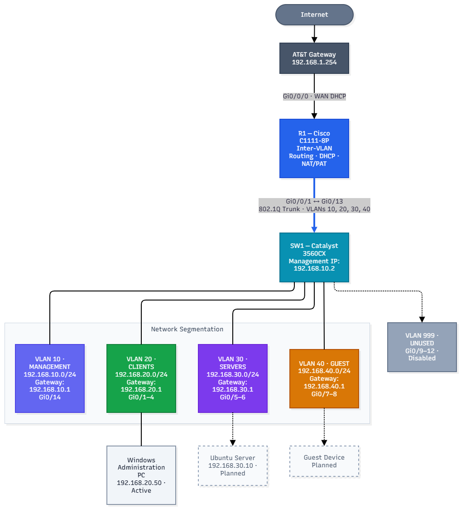

# Cisco Home Network Lab

I built this network using a Cisco router and switch to practice configuring and troubleshooting a real network. The lab covers VLANs, routing, DHCP, NAT, access control lists, and switch security.

## Network Topology

R1 connects to an ISP gateway for internet access. R1 and SW1 use an 802.1Q trunk to carry four VLANs. R1 handles inter-VLAN routing and NAT, while SW1 connects devices to their assigned VLANs.

## Equipment

| Device | Model | Role |
|---|---|---|
| Router (R1) | Cisco C1111-8P | Inter-VLAN routing, DHCP, NAT, ACLs |
| Switch (SW1) | Cisco Catalyst WS-C3560CX-12PC-S | VLANs, trunking, Layer 2 security |
| ISP gateway | ISP-provided router | Internet uplink |
| Test devices | Windows and Linux systems | Connectivity and SSH testing |

[Physical equipment photos](photos/README.md)

## VLANs

| VLAN | Name | Subnet | Gateway |
|---|---|---|---|
| 10 | MANAGEMENT | 192.168.10.0/24 | 192.168.10.1 |
| 20 | CLIENTS | 192.168.20.0/24 | 192.168.20.1 |
| 30 | SERVERS | 192.168.30.0/24 | 192.168.30.1 |
| 40 | GUEST | 192.168.40.0/24 | 192.168.40.1 |
| 999 | UNUSED | None | None |

SW1 uses `192.168.10.2` for management. The R1-to-SW1 trunk connects R1 `Gi0/0/1` to SW1 `Gi0/13`.

## What I Configured

- VLANs and access ports on SW1
- 802.1Q trunking and router-on-a-stick on R1
- DHCP for client and guest VLANs, including an IP reservation
- NAT overload (PAT) for internet access
- SSH management restricted by an ACL
- Guest VLAN IPv4 access restrictions
- A client VLAN ACL limiting access to the server VLAN
- Rapid PVST+, PortFast, and BPDU Guard
- DHCP Snooping on VLANs 20 and 40
- Dynamic ARP Inspection (DAI) on VLANs 20 and 40
- NTP and shutdown of unused interfaces

## Testing

I tested VLAN assignments, trunk forwarding, router connectivity, internet access, SSH, and DHCP Snooping. On VLAN 20, DAI forwarded ARP traffic without dropping valid packets.

Some tests are still pending. In particular, I need to verify the client-to-server deny rule using a separate client and retest guest connectivity after enabling DAI on VLAN 40.

[Read the verification results](documentation/verification-tests.md)

## Files

- [R1 sanitized configuration](configurations/R1-sanitized.cfg)
- [SW1 sanitized configuration](configurations/SW1-sanitized.cfg)
- [Verification results](documentation/verification-tests.md)
- [Editable network diagram](diagrams/network-topology.drawio)
- [Equipment photos](photos/README.md)

The published configurations have passwords, certificates, serial numbers, and client identifiers removed. They are for reference, not complete device backups.

## Project Status

The core network configuration is complete and operational. I verified routing, VLAN connectivity, NAT, SSH management, DHCP Snooping, and Dynamic ARP Inspection on VLAN 20.

The remaining validation items are documented in [Network Verification](documentation/verification-tests.md).
