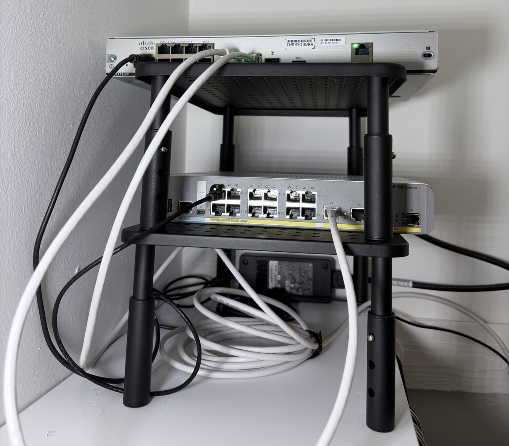
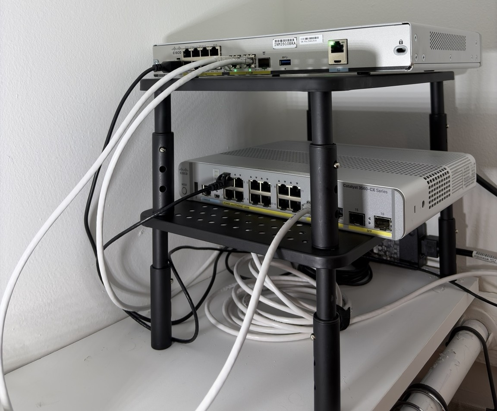

## Physical Hardware Deployment

The network is deployed using a Cisco C1111-8P router and Catalyst 3560CX switch installed on a compact open-frame equipment shelf.

The router provides routing and network services, while the Catalyst switch handles VLAN segmentation and endpoint connectivity.

### Physical Network Setup

### Additional Hardware View

